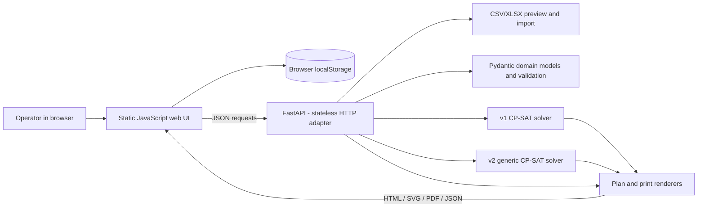

# Architecture and operational boundaries

This document describes the implementation on the `main` branch. Read [build-plan.md](build-plan.md) for product scope and [scoring-principles.md](scoring-principles.md) for solver policy.

## Components and data flow



The browser is an API client, not a second optimizer. The Python package can also be used directly without HTTP or a browser. A solve consumes an entire problem payload and returns plan data; the API keeps no server-side planning sessions or user accounts.

## Implementation map

| Layer | Primary files | Responsibility |
| --- | --- | --- |
| Domain and validation | `src/seating_optimizer/models.py`, `generic_rules.py` | Guests, parties, tables, floors, rules, plans, typed generic mechanisms |
| Import and layout | `importer.py`, `layout_io.py`, `header_aliases.json` | CSV/XLSX input, column mapping, geometry |
| Legacy optimizer | `solver.py`, `adjacency.py`, `pattern_rules.py` | v1 constraint modeling, objective scoring, staged and split seating |
| Generic optimizer | `generic_solver.py`, `generic_cp.py`, `generic_evaluator.py`, `equivalence.py` | v2 typed mechanisms, CP-SAT model and scoring |
| Reassignment and output | `reassignment.py`, `exporters.py`, `list_exports.py`, `print_exports.py` | Solver-checked moves, explanations, exports |
| HTTP adapter | `api/app.py`, `api/openapi.yaml` | v1/v2 endpoints and API contract |
| Browser | `api/web/app.js`, `v2-rules.js`, `plan-workspace.js`, `style.css` | Four primary screens, editors, operator review, previews and local session persistence |

The package uses Python 3.11+, OR-Tools CP-SAT, Pydantic, openpyxl and ReportLab. The API uses FastAPI/Uvicorn. The browser is native JavaScript/CSS, with Node 22, jsdom and Playwright for UI tests.

## Primary workflows

1. **Import:** the browser previews a CSV/XLSX source via `/v1/import/preview`, allows column mapping and calls `/v1/import`. Guest data and source metadata can be retained in browser storage.
2. **Configure:** edit floors, table capacities/geometry and rule instances. The v2 mechanism registry is served from `/v2/rules/catalog`; configurations can be validated and v1 configurations migrated through v2 endpoints.
3. **Solve:** the browser submits the complete problem to `/v2/solve`. CP-SAT enforces hard constraints and optimizes soft objectives. A feasible but unproven optimum is not called optimal; infeasible and unknown are distinct outcomes. v1 `/v1/solve` remains available for compatibility.
4. **Review/reassign:** the operator reviews assigned and unseated parties; `/v2/reassign/options` supplies checked movement choices for a proposed manual instruction. UI edits must not bypass server validation.
5. **Export:** v1 and v2 expose table/JSON, people/table/not-seated HTML, floor SVG/PDF and table-card PDF outputs. Exports use plan data rather than a separately recomputed seat assignment.

## Trust and security boundaries

- **Local-only by default.** Run `uvicorn seating_optimizer.api.app:app --host 127.0.0.1 --port 8000`. The current API has no authentication, per-user access control or rate limiting; it must not be exposed directly to an untrusted network. A public or shared deployment requires an explicitly designed authenticated and access-controlled gateway and a separate security review (tracked by issue #86).
- **Browser persistence.** `app.js` saves the active planning session to `seating-optimizer:session:v2` and templates to `seating-optimizer:templates:v2` in origin-scoped `localStorage`. The snapshot can include guest names, attributes, the import source file, layout and generated plans. Clearing an active UI form does not by itself promise to remove all previously saved templates or older storage keys. On a shared device, use a private browser profile or clear site data when appropriate. A formal retention/deletion feature remains open in issue #85.
- **API ingestion.** Spreadsheet content reaches `/v1/import` or preview in base64 inside JSON. Geometry and rule payloads cross the browser/API boundary and are validated by the server. Treat imported names, notes and attributes as untrusted data; do not put confidential production records in test fixtures, logs or screenshots.
- **External dependencies.** Python packages and browser test tooling are installed from package registries. No externally hosted optimization service is required: OR-Tools runs in the Python process. The included API docs use Scalar; ensure external frontend asset policies are reviewed for offline deployment if applicable.
- **Persistence split.** The FastAPI adapter itself is stateless; browser `localStorage` is not backed up by the API. Export configuration and input data before clearing browser storage. There is no multi-user conflict-resolution or shared account model.

## Build, run, verify, deploy

```bash
python -m venv .venv
. .venv/bin/activate
python -m pip install -e ".[api,test]"
python -m pytest -v -s
uvicorn seating_optimizer.api.app:app --host 127.0.0.1 --port 8000
```

Open `http://127.0.0.1:8000/` for the browser UI and `/docs` for Scalar documentation; `/openapi.yaml` is the checked-in API contract. For browser checks, install Node 22 and browser dependencies, run `npm run test:ui`, then `npx playwright install --with-deps chromium` and `npm run test:browser` while following the project's Playwright configuration. GitHub Actions in `.github/workflows/test.yml` runs Python 3.11/3.12 and Node/Playwright checks; these do not replace hands-on testing of a deployed UI.

Do not bind the API to `0.0.0.0` on a publicly reachable host without completing the #86 network-authentication work. Production deployment, retention policy and multi-user use are not yet accepted capabilities.

## Maintenance contract

Update this document in the same PR as any change to data ownership, storage keys, API boundaries, solver architecture, trust policy, installation or deployment. See issues #85, #86, #87 and #88 for unresolved security and invariant work. This orientation is documentation, not a claim that those issues are completed.
